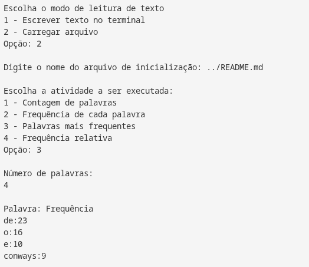
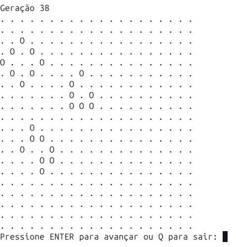

# lp-analise-da-vida

Projeto desenvolvido para a disciplina Aspectos de Linguagens de Programação (BCC6002) da Universidade Tecnológica Federal do Paraná (UTFPR), pelos alunos:

- André Felipe Wonsik Alves
- Eber Felipe Barrotti Louback
- Erick Molina Gehring
- Gustavo Martins França

O projeto contém duas aplicações: Analisador de Textos e Frequência de Palavras (`texto/`); e o Jogo da Vida de Conway (`conways/`). Ambas foram implementadas em Haskell.

## Exemplo de uso

### Analisador de textos

Execute o seguinte comando para iniciar o sistema:

```bash
make text
```

Escolha se o modo de entrada vai ser um texto escrito manualmente pelo terminal ou se será um arquivo. Caso seja um arquivo, o seu caminho precisa ser informado.

Tendo a fonte do texto informada, o usuário deve escolher se o programa deve remover palavras pouco relevantes como artigos, preposições, conjuções, etc.

Após isso, selecione qual análise será realizada entre as seguintes:

- Contagem de palavras: Imprime o número total de palavras no texto
- Frequência de cada palavra: Imprime uma tabela associando as palavras do texto com o número de vezes que aparece
- Palavras mais frequentes: Pergunta quantas palavras serão exibidas e imprime as mais frequentes com o número de vezes que aparece
- Frequência relativa: Imprime uma tabela com todas as palavras e sua proporção de ocorrência

Para as opções que imprimem tabelas o programa irá perguntar se a tabela deve ser ordenada alfabeticamente ou com base na frequência.

A Figura abaixo demonstra a execução do programa para palavras mais frequentes com o próprio `README.md` como base.

### ATUALIZAR ESSA FIGURA DEPOIS



### Conway's Game of Life

Em um terminal, execute:

```bash
make conways
```

Digite o nome do arquivo de inicío dentre os listados. Os arquivos utilizados para teste representam alguns padrões  conhecidos do jogo:

- mini_glider.txt
- pulsar.txt
- glider.txt
- r_pentomino.txt
- oscilators.txt

Os arquivos de texto estão no diretório `conways/data/`.

Após selecionar um arquivo, escolha um dos seguintes modos de execução:

- Manual
- Contínuo

No modo manual, uma nova geração é compudata e exibida ao pressionar ENTER, e é possível parar a execução com o caractere `q` ou `Q`.

No modo automático, uma nova geração é computada e exibida após um intervalo de tempo. Ao selecionar esse modo, é possível definir esse intervalo de tempo (em segundos) e a quantidade de iterações do jogo.

Na Figura abaixo, está ilustrado o estado do jogo após 38 iterações a partir do arquivo `data/r_pentomino.txt`, modo manual.



## Construções e Conceitos de Programação Funcional

Os conceitos de programação funcional utilizados neste trabalho e as funções que os aplicam estão ilustradas na Tabela abaixo. Há comentŕios no código fonte das funções citadas detalhando o uso do conceito respectivo.

| Conceito | Arquivo | Funções |
| :--- | :--- | :--- |
| List Comprehensions | `conways/Rules.hs` | `proximaGeracao`, `contarVizinhos` |
| Recursão | `conways/Main.hs` | `loopContinuo`, `loopManual` |
| Recursão | `conways/CustomIo.hs` | `lerArquivo`, `lerInteiro`, `lerModo`, `lerComando` |
| Recursão | `conways/Environment.hs` | `distribuir` |
| Funções de Ordem Superior | `conways/CustomIo.hs` | `lerInteiro` |
| Map | `conways/Environment.hs`, `text/Analyser.hs` | `popularMatriz`, `_normalizarTexto` |
| Lambda | `text/Analyser.hs` | `_normalizarTexto` |
| Fold | `text/Analyser.hs` | `_enumerarPalavras` |
